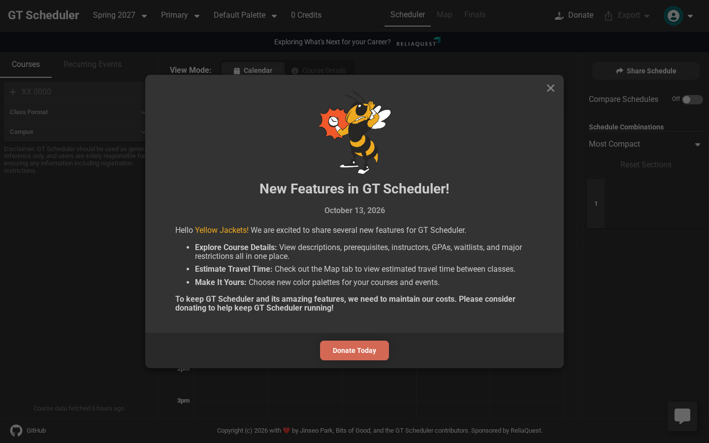
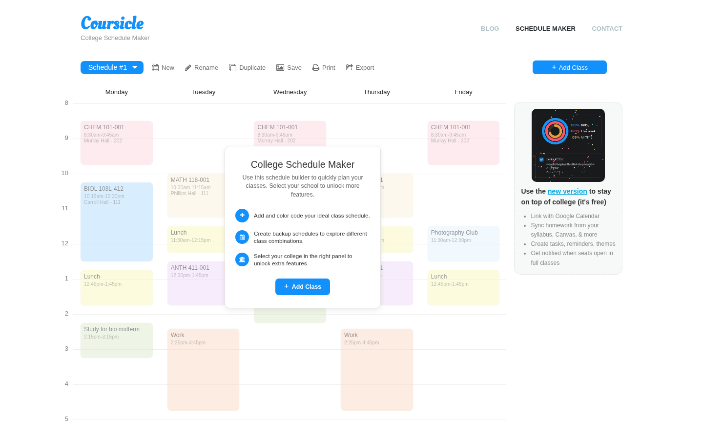
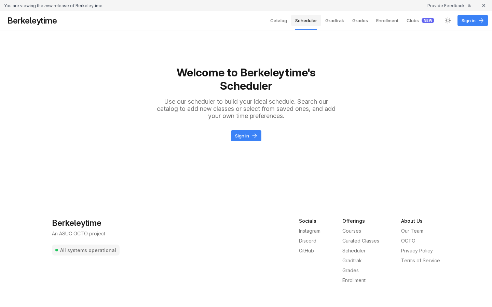
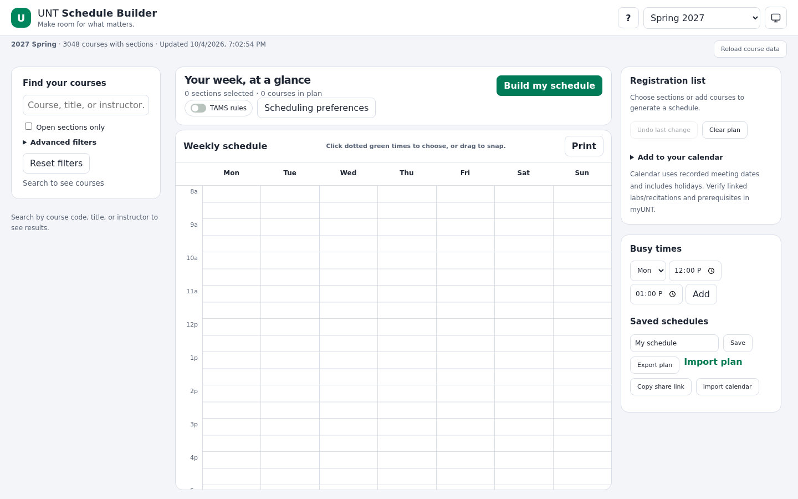
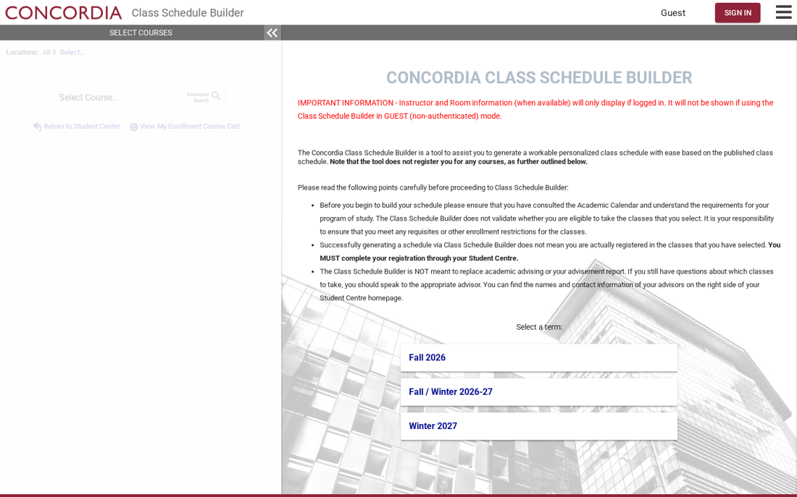
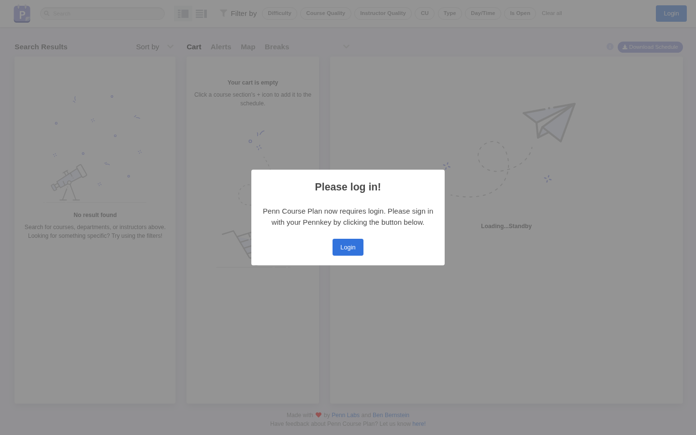

# How the best schedule builders work, and what UNTangle should do

Research pass, October 15, 2026. The task: study the schedule builders students actually
rate, read the open-source generation code where it exists, and turn it into a ranked,
buildable backlog for UNTangle's Week view and Auto. Every load-bearing claim carries a
URL to something read or captured this session. Repo file paths in the recommendations
were read on `alpha` at commit `1c205c2e` the same day.

Evidence classes used below, matching the conventions of
`docs/research/registration-platforms/`:

- **Verified this session** means a page, repository file, or screenshot I opened on
  October 15, 2026. Each carries its URL.
- **Student voice (secondary)** means Reddit threads and blog posts surfaced through a
  cited web search; they are used for what students praise and complain about, never for
  how a product works internally.
- **Read in source** means the named file was fetched from the cited repository this
  session.

## Captures

Public demo pages, captured October 15, 2026 with headless Chromium at 1440x900. Each
capture is stored in `captures/` next to this file and is under 300 KB. The pages are
live products and change without notice, so each capture records what it shows.

| File | Page | Source URL | What it shows |
| --- | --- | --- | --- |
| `captures/gt-scheduler.png` | GT Scheduler (Georgia Tech) | https://gt-scheduler.org/ | Course pane, sorting dropdown at "Most Compact", Schedule Combinations counter, Finals and Map tabs, donation modal listing course details with GPA, waitlists and major restrictions |
| `captures/coursicle-maker.png` | Coursicle schedule maker | https://www.coursicle.com/college-schedule-maker/ | Multiple named schedules ("Schedule #1"), New, Rename, Duplicate, Save, Print, Export controls, colored week grid with lunch and work blocks, "+ Add Class" rail |
| `captures/berkeleytime.png` | BerkeleyTime scheduler | https://berkeleytime.com/schedules | Scheduler requires sign-in; the nav shows Catalog, Scheduler, GradTrak, Grades, Enrollment; footer says "An ASUC OCTO project" |
| `captures/vsb-unt-mirror.png` | UNT Schedule Builder (volunteer mirror at untgrades.app) | https://vsb.untgrades.app/ | "Spring 2027, 3048 courses, updated 10/4/2026", TAMS rules toggle, Registration list, Busy times, Saved schedules with export, import, share link and calendar import, add-to-calendar note about myUNT |
| `captures/vsb-concordia.png` | Visual Schedule Builder at Concordia | https://vsb.concordia.ca/ | The official VSB deployment's criteria step (it redirects to `/criteria.jsp` before showing a timetable) |
| `captures/penncourseplan.png` | Penn Course Plan | https://penncourseplan.com/ | Search results pane with Filter by Difficulty, Course Quality, Instructor Quality, CU, Type, Day/Time, Is Open; Cart, Alerts, Map, Breaks tabs; a "Please log in" modal (Penn Course Plan now requires PennKey sign-in) |

---

## 1. Visual Schedule Builder (VSB)

VSB is the timetable builder UNT students used for years; a volunteer mirror still runs
at https://vsb.untgrades.app/ and is the same surface UNTangle's section data comes from
(`frontend/src/lib/sections/config.ts` fetches its per-term file). Concordia's official
deployment at https://vsb.concordia.ca/ shows the product shape: a criteria step (term,
courses, breaks), then a generated timetable.

**How students collect courses.** Search a course code or title, add course options, and
the builder combines section choices. The UNT mirror adds "Open sections only" and
advanced filters, a TAMS rules toggle, and search by "Course, title, or instructor"
(verified in `captures/vsb-unt-mirror.png`, source above).

**Generation, locking, breaks, paging.** The builder generates feasible combinations and
lets the student move between them; breaks are entered as busy times. Civitas Learning's
comparable product publicly describes generating "all potential schedules" and comparing
them using breaks and preferences
(http://www.civitaslearning.com/wp-content/uploads/2025/01/Academic-Planning-Overview.pdf).
The UNT mirror exposes exactly this loop: "Build my schedule", a weekly grid where
"Click dotted green times to choose, or drag to snap", Busy times with a day/time picker,
and a Registration list of chosen sections (verified in `captures/vsb-unt-mirror.png`).

**Conflicts, seats, waitlists.** Conflicting sections are simply excluded from valid
combinations, which is the product's core trick, and the UNT mirror shows seat rules
through "Open sections only". Seat counts come from the registration system; VSB itself
reserves nothing.

**Handoff to registration.** The UNT mirror's Registration list says: "Choose sections
or add courses to generate a schedule", then "Add to your calendar... Verify linked
labs/recitations and prerequisites in myUNT" (verified in `captures/vsb-unt-mirror.png`).
A Seneca student describes the same handoff: build the timetable in VSB, then send the
selected classes to the course cart (https://www.reddit.com/r/Seneca/comments/1h0t75e/how_to_build_timetable/).

**What students praise.** The week-at-a-glance calendar and not having to hand-check
every lecture/lab combination (https://www.reddit.com/r/Seneca/comments/1h0t75e/how_to_build_timetable/).
UNT students have begged for a working builder outright: "COMPUTER SCIENCE MAJORS!!!
REMAKE VISUAL SCHEDULE BUILDER, AND MY LIFE IS YOURS"
(https://www.reddit.com/r/unt/comments/1ss1cew/computer_science_majors_remake_visual_schedule/).

**What students complain about.** Reliability at exactly the wrong moment: Seneca
students report the builder unavailable, frozen, or cleared during enrollment windows
(https://www.reddit.com/r/Seneca/comments/i3ijtc/anyone_having_issues_enrolling_into_literally/,
https://www.reddit.com/r/Seneca/comments/p1770l/schedule_builder_not_working/,
https://www.reddit.com/r/Seneca/comments/i3lmia/early_enrollment_sucks/), and UNT
students had weeks-long outages in January 2020
(https://www.reddit.com/r/unt/comments/ej5maq/visual_schedule_builder/). Wrong or
nonsensical conflict reports
(https://www.reddit.com/r/Seneca/comments/i3ijtc/anyone_having_issues_enrolling_into_literally/).
And the planning-enrollment gap: a schedule built the night before is worthless when
sections fill or the cart empties by morning
(https://www.reddit.com/r/Seneca/comments/i3ijtc/anyone_having_issues_enrolling_into_literally/).
UNT replaced VSB's MyUNT embedding with a schedule feature inside the online degree
audit, which students received badly: "New Schedule builder is Hell"
(https://www.reddit.com/r/unt/comments/1rvpclh/new_schedule_builder_is_hell/) and
"Did they really choose to complicate the scheduling process tenfold for no apparent
reason" (https://www.reddit.com/r/unt/comments/1rpjlg1/vsb/).

## 2. Civitas Learning College Scheduler

Studied from vendor documentation only this session; no independent student reviews
surfaced, so its section is thinner by design
(http://www.civitaslearning.com/wp-content/uploads/2025/01/Academic-Planning-Overview.pdf).

**How it works.** Scheduling is embedded in academic planning: the student's degree plan
names the courses needed for the term, the system generates schedules from planned
courses, breaks and preferences, and flags barriers such as duplicate courses, missing
prerequisites and corequisites, and courses not offered in the planned term. It
advertises building conflict-free schedules and "streamlined registration advising" for
students who planned but have not registered. The lock control and the seat/waitlist
display are institution-configured and not documented publicly; nothing here is claimed
about them.

**Lesson for UNTangle.** The product bet is that the schedule builder should read the
student's degree plan, not just a hand-typed course list. UNTangle already encodes 15
UNT degree plans (per project knowledge; encoding notes at
`docs/research/degree-plans/encoding-notes.md`), so Auto could offer "build my week from
my degree plan's next-term recommendations" without new data infrastructure.

## 3. Coursicle

**How students collect courses.** Coursicle comes preloaded with an institution's
classes; the student adds classes to one or more named schedules on a colored week grid,
with backup schedules to explore combinations, conflict detection, and lunch or work
blocks drawn on the grid (verified in `captures/coursicle-maker.png`;
product description at https://www.coursicle.com/blog/what-is-coursicle/ and
https://www.coursicle.com/college-schedule-maker/).

**Seats and alerts.** Coursicle's most praised feature is seat tracking: watch a full
class and get a notification when a seat opens
(https://www.reddit.com/r/Coursicle/comments/1mby86r/what_is_coursicle/,
https://play.google.com/store/apps/details?id=com.coursicle.coursicle&hl=en_US).

**Complaints.** Some students resent scope creep away from the one thing they want:
"I'm just looking to be alerted when the classes become available"
(https://www.reddit.com/r/Coursicle/comments/1jomyax/summer_course_tracking_for_the_love_of_god/).
Seat and waitlist monitoring is institution-specific; a UCSB-only waitlist feature is
cited in the same thread.

**Handoff.** None; Coursicle plans, the university system registers.

## 4. UT Registration Plus (UTRP)

UTRP is a Chrome extension that augments UT Austin's own registration pages rather than
replacing them (student description: "It'll basically just add elements to the webpage
when you look at the course schedule, you'll see a little bar graph on the right side
that gives you more information about the class"
https://www.reddit.com/r/UTAustin/comments/14mla9y/using_the_ut_registration_plus_extension/).

**What it adds to the registration page.** Enrollment visualization, Rate My Professors
links, past syllabi, grade distributions, a weekly schedule view of the classes you
added, and a reminder that adding a class to UTRP "is only for planning; it does not
register the student" (V2 release announcement claiming 60,000+ students helped:
https://www.reddit.com/r/UTAustin/comments/1g6s585/ut_registration_plus_v2_has_released/).

**Version 2's Schedule Backup** exists because students previously maintained
spreadsheets of fallback sections in case a preferred schedule failed at registration
(https://www.reddit.com/r/UTAustin/comments/1g6s585/ut_registration_plus_v2_has_released/).

**Student story worth keeping.** A student signed up for two classes 23 minutes apart
with a 10-minute passing period, had not checked the locations beforehand, and used UTRP
to reorganize during add/drop
(https://www.reddit.com/r/UTAustin/comments/1vgt4y1/since_summer_orientation_is_wrapping_up_what/).
This is the walking-time check UNTangle already enforces in its optimizer; it is the
kind of save worth advertising in product copy.

## 5. GT Scheduler (open source)

Georgia Tech's student-built scheduler, maintained at the gt-scheduler organization,
described there as "a scheduling application designed to mitigate some of the
pain-points present throughout Georgia Tech's registration process"
(https://github.com/gt-scheduler). The original repository by the first author is
archived and read-only (https://github.com/64json/gt-scheduler). Site:
https://gt-scheduler.org/ (verified in `captures/gt-scheduler.png`).

**How students collect courses.** Add desired course codes to the Courses pane; section
data comes from a periodic crawler of Georgia Tech's Banner (Oscar)
(https://github.com/gt-scheduler/crawler). Live seat counts are fetched at request time
through a proxy to Banner's `getEnrollmentInfo` endpoint:
`src/controllers/classSection.ts` in https://github.com/gt-scheduler/backend (read this
session).

**Generation algorithm, read in source.** The combination generator is a depth-first
search over the desired courses in `Oscar.getCombinations`,
`src/data/beans/Oscar.ts` in https://github.com/gt-scheduler/website (fetched from
`https://raw.githubusercontent.com/gt-scheduler/website/main/src/data/beans/Oscar.ts`
this session). Its rules:

- For each course in order, try each section group; a section is skipped if it is
  excluded, or conflicts with any already-chosen section or with a student event
  (break). Conflicts come from `hasConflictBetween` on meeting periods.
- Locked sections (pinned CRNs) are enforced structurally: if a course has a pinned
  section, the DFS recurses without adding a choice for it. If a pinned lecture and a
  pinned lab both exist, the course contributes nothing to branch on.
- Lecture-plus-lab courses are handled as pairs: the DFS enumerates lecture and lab
  combinations through `onlyLectures`, `onlyLabs` and `allInOnes`, so a lecture is never
  chosen without a valid lab and standalone all-in-one sections are tried separately.
- If no lecture-lab pair progresses (VIP courses with no sections), the course is
  silently dropped rather than stalling the search.
- The DFS output is every conflict-free combination; nothing is pruned by quality, so
  the result count can be large.

**Ranking, read in source.** `sortingOptions` on the same `Oscar` class defines three
explicit, human-named sortings, each a cheap computation over the combination's per-day
start and end maps (with the student's events folded in): "Most Compact" (minimize the
sum of daily span), "Earliest Ending" (minimize average end time), "Latest Beginning"
(maximize average start time). The combinations list is virtualized and every row shows
a small calendar preview; hovering previews it on the big calendar and clicking a
combination pins all of its CRNs (`src/components/CombinationContainer/index.tsx`,
https://github.com/gt-scheduler/website, read this session).

**Conflicts, seats, waitlists.** Conflicts never reach the list; live enrollment is the
Banner proxy above. The site's own what's-new modal (captured October 13, 2026,
`captures/gt-scheduler.png`) advertises "View descriptions, prerequisites, instructors,
GPAs, waitlists, and major restrictions all in one place" and a Map tab with "estimated
travel time between classes".

**Handoff.** Select a combination, sections are pinned, and registration happens in
Banner; GT Scheduler registers nobody.

**Structure worth copying.** The whole loop: named sortings a student can reason about,
a browsable list of every combination with previews, and one-click pinning of any
combination.

## 6. Penn Course Plan (open source)

Penn Labs' planner. The original repo is archived; development moved to
`pennlabs/penn-courses` (notice on https://github.com/pennlabs/penn-course-plan).
Penn Labs' design writeup is the best public document on why students abandon official
tools: information is "spread across many different sites and tools", and building a
mock schedule on Penn InTouch means toggling between pages
(https://pennlabs.org/blog/the-design-of-penn-course-plan-under-the-hood/, read this
session).

**How students collect courses.** A course cart plus multiple mock schedules, with
filters for quality, difficulty, course units, and type, and per-schedule statistics:
average quality, difficulty, workload, total credits and hours of class time
(https://pennlabs.org/blog/the-design-of-penn-course-plan-under-the-hood/). The live
site (captured in `captures/penncourseplan.png`) shows the same panes: Filter by
Difficulty, Course Quality, Instructor Quality, CU, Type, Day/Time, Is Open, with Cart,
Alerts, Map and Breaks tabs, now behind PennKey login.

**Schedule generation, read in source.** Penn Course Plan's solver is an unmerged pull
request: "Schedule Solver Feature", open against `master` from branch `schedule-solver`
(https://github.com/pennlabs/penn-courses/pull/539, files read this session). Its
algorithm in `backend/courses/util.py`:

- Sections are split into lectures and recitations per course
  (`find_sections`).
- For each day, sections and breaks become intervals; sections overlapping any break
  are removed up front.
- A dynamic program over intervals sorted by end time computes the maximum set of
  non-overlapping intervals per day (the classic weighted-interval-scheduling DP, here
  unweighted, with the constraint that adjacent intervals belong to different courses),
  then backtracks to recover one optimal day.
- One section per course is kept, chosen at random among the course's intervals on the
  recovered schedule (a `whitelist` exception can keep multiple); a small random
  epsilon is added to end times to jitter ties.
- The endpoint `POST /plan/scheduler/` takes courses, semester, breaks and a credit
  limit (`backend/plan/views.py`, `AutomaticCourseScheduler`, same PR).

So Penn's approach is per-day interval maximization with randomized tie-breaking, not
exhaustive enumeration like GT Scheduler and not preference-cost optimization like
UNTangle. It finds one good schedule, not every schedule.

**Seats and waitlists, read in source.** Master's `backend/courses/util.py` maintains
`percent_open` on every section: each status update is folded into a time-weighted
average of the fraction of the add/drop window during which the section was open
(fetched from
`https://raw.githubusercontent.com/pennlabs/penn-courses/master/backend/courses/util.py`
this session). That is historical fill evidence, not a live count, and it is computed
from the site's own status-update stream.

## 7. BerkeleyTime

A Berkeley ASUC OCTO student project with Catalog, Scheduler, GradTrak, Grades and
Enrollment sections (nav verified in `captures/berkeleytime.png`; feature
overview at https://berkeleytime.com/grades: "the catalog, scheduler, grades, and
enrollment. Log in to select classes by instructor and view detailed grading options").
Its scheduler requires sign-in (verified in `captures/berkeleytime.png`), so its
generation internals could not be verified this session and are not characterized here.

**What students use it for.** Historical grade distributions by instructor, enrollment
trends showing how fast sections fill, and course discovery; a Berkeley peer-adviser
podcast describes combining it with the official planner for final schedule construction
(https://engineering.berkeley.edu/podcast/ess-605-enrollment-tips-with-ess-peer-advisers/).
The pattern: BerkeleyTime owns evidence and research, Cal Central owns the official
schedule.

## 8. Patterns the best builders share

Across the products above, the loop that students keep choosing is:

1. **Collect** from a preloaded, seat-aware catalog (VSB mirror, Coursicle, GT) rather
   than a hand-typed list.
2. **Generate** everything conflict-free, then **rank with named, explainable criteria**
   (GT's "Most Compact", UTRP's bar graphs, Penn's per-schedule quality statistics).
3. **Browse the results as small previews and pin any of them** (GT's combination list,
   Coursicle's backup schedules, VSB's paging).
4. **Show evidence, not just counts**: grades, GPA, waitlists, travel time
   (GT), enrollment history (BerkeleyTime), percent-open (Penn).
5. **Hand off honestly**: class numbers into the registration cart, with explicit
   "this does not register you" language (VSB mirror, UTRP).
6. **Survive registration week**: the loudest complaint in every student thread is
   failure during the enrollment window (VSB outage threads above), and the best
   answer students found was tooling that kept working when official systems buckled
   (UTRP, Coursicle alerts).

---

## What UNTangle should do

UNTangle's engine is already ahead of every product above in one way: it is a
preference-cost optimizer with hard constraints, locks, exclusions, walking checks,
dated meetings, infeasibility explanations with checked suggestions, and a proven
deterministic search (`frontend/src/lib/optimizer/README.md`, read this session). PR #58
(the v3 Week rebuild, open) covers export, class numbers, share links, keep-this-section
locking, and a one-alternative-at-a-time strip; PR #61 (open backlog) covers instructor
ratings and campus calendars. The recommendations below deliberately avoid duplicating
either, and each says where it stands relative to them.

Ranked by value to a UNT student:

### 1. Break Auto's ties by seat availability

**The change.** When two schedules cost the same under the student's preferences, rank
the one whose sections are all open first; today a closed or waitlisted section ties
freely because seats are only a filter (`openSeatsOnly`) and a reason warning
(`frontend/src/lib/reasons/scheduleReasons.ts` refuses to rank a not-open section away,
but the cost function itself is seat-blind). Add seat status as a cost term after the
instructor-strength evidence term (merged in PR #79) and before the section-id order,
and let Auto include a waitlisted section when it wins on cost,
saying so in the alternative's detail line.

**Why.** The registration-night failure students describe is a schedule that dies
because a full section was ranked indifferently (VSB and Seneca threads in section 1).
GT Scheduler fetches live enrollment at request time
(https://github.com/gt-scheduler/backend) and shows waitlists; Coursicle's whole seat
business exists for this (section 3).

**Files.** `frontend/src/lib/optimizer/score.ts` (tiebreak term),
`frontend/src/lib/optimizer/prepare.ts` (carry status into candidates),
`frontend/src/lib/reasons/scheduleReasons.ts` (reason copy for a waitlisted pick).

**Acceptance check.** An engine test builds two schedules over the same times where one
uses a closed section; the open-section schedule sorts first, and with statuses equal the
existing section-id tiebreak still orders deterministically. A regression test pins that
the seat term is 0 when every section is open, so existing pinned costs do not move.

### 2. Historical fill-rate evidence on every section

**The change.** Snapshot each term section's seat counts on a schedule (the section file
is already cached per process), store the history, and show on a section row how fast
the section has filled in past terms and how open it has stayed this term, e.g.
"usually full by the first day". Abstain from any claim with fewer than two snapshots.

**Why.** Penn computes exactly this as `percent_open`, a time-weighted fraction of the
add/drop window a section sat open
(https://github.com/pennlabs/penn-courses, `backend/courses/util.py`); BerkeleyTime's
enrollment histories are the feature Berkeley students cite it for
(https://engineering.berkeley.edu/podcast/ess-605-enrollment-tips-with-ess-peer-advisers/).
UNTangle has `Section.seats` and `Section.status` (`frontend/src/lib/sections/model.ts`)
but throws the history away.

**Files.** New `frontend/src/lib/sections/fill-history.ts` (accumulator and rates);
`packages/ingest/src/section-release.ts` (write the seat snapshot into each governed
release); `frontend/src/lib/reasons/scheduleReasons.ts` (a reason line); new
`frontend/src/components/schedule/FillRateNote.tsx` (the note under a section row,
modeled on the existing `SampleNote.tsx`).

**Acceptance check.** A fixture test feeds two synthetic snapshots (open at t0, full at
t1) and asserts the computed rate and the "usually fills early" label; a second test
asserts abstention (no claim rendered) with a single snapshot, matching the repo's
abstain-when-evidence-is-thin rule.

### 3. Watch a full section from a saved plan

**The change.** A saved plan that depends on a closed or waitlisted section gets a Watch
entry: UNTangle polls the section's status on its existing snapshot job and shows an
in-app badge (and later a digest) when it opens. No push infrastructure in the first
cut; the watch list is computed from the saved-plan store plus the newest section data.

**Why.** Seat alerts are Coursicle's single most praised feature
(https://www.reddit.com/r/Coursicle/comments/1mby86r/what_is_coursicle/) and the exact
gap students fill by refreshing myUNT. UTRP's Schedule Backup exists for the same
panic (https://www.reddit.com/r/UTAustin/comments/1g6s585/ut_registration_plus_v2_has_released/).

**Files.** `frontend/src/lib/saved-plans/store.ts` (enumerate pinned sections per plan);
new `frontend/src/lib/sections/watch.ts` (plan-by-plan feasibility check against current
statuses); new `frontend/src/app/api/sections/watch/route.ts`, following the shape of
the existing `frontend/src/app/api/sections/[term]/[subject]/[number]/route.ts` and
reusing its `withRateLimit("sections", ...)` budget.

**Acceptance check.** A test with a saved-plan fixture naming one waitlisted section and
a sections fixture where it is open returns the plan in the watch result with reason
"CSCE 1030-030 opened"; the same fixtures with the section still closed return no entry.
No network in tests; both fixtures committed with their source recorded.

### 4. Final-exam conflict checking

**The change.** Ingest UNT's published final-exam blocks (by class number) for the
planning term, carry an optional exam meeting on each section, and make overlapping exam
blocks a hard conflict in Auto plus a named clash in the Week answer line.

**Why.** GT Scheduler ships a Finals tab as a headline feature (captured in
`captures/gt-scheduler.png`, https://gt-scheduler.org/); no other builder in this study
does it, and nothing in UNTangle reads exam data today (grep for exam in
`frontend/src/lib` and `frontend/src/components/schedule` finds only syllabus parsing).
PR #58's ICS export deliberately excludes finals week, so the term calendar source it
uses (`lib/terms/terms.ts`) already knows which days are finals days.

**Files.** `frontend/src/lib/sections/model.ts` (optional `exam` meetings per section or
per class number), `frontend/src/lib/optimizer/prepare.ts` and `optimize.ts` (exam
conflicts join the hard constraints), `frontend/src/lib/reasons/scheduleReasons.ts`, new
`packages/ingest/src/exam-schedule.ts` (the exam-schedule ingest, beside the existing
`section-release.ts` and `source-policies.ts`).

**Acceptance check.** An engine test with two sections whose exam blocks overlap proves
infeasible with an explanation naming the exam conflict, and a control test with
non-overlapping exams stays feasible. Until real exam data lands, the fixture records
its synthetic construction explicitly, per the repo's fixture rules.

### 5. A browse-all Combinations mode above the one-at-a-time strip

**The change.** Keep PR #58's strip as the default answer, but add a mode that lists
every conflict-free combination (or the first N) as small week previews with the chosen
section names; hovering previews on the grid, clicking issues the locks. Raise the
optimizer's `k` for this mode and render with a virtualized list.

**Why.** This is GT Scheduler's core interaction, read in source:
a virtualized combination list with calendar previews where clicking pins all CRNs
(https://github.com/gt-scheduler/website, `src/components/CombinationContainer/index.tsx`,
`src/data/beans/Oscar.ts`). Coursicle's backup schedules serve the same browse-many
instinct (https://www.coursicle.com/college-schedule-maker/). UNTangle's diversity rule
returns 3 alternatives that "differ in a way a student would notice", which is the right
default and the wrong ceiling.

**Files.** `frontend/src/lib/optimizer/optimize.ts` (raise or parameterize `k`),
`frontend/src/lib/optimizer/README.md` (contract update), new
`frontend/src/components/schedule/CombinationsList.tsx` beside
`AlternativesCompare.tsx`, `frontend/src/components/schedule/use-optimizer.ts` (fetch
the full result set for the mode).

**Acceptance check.** An engine test asserts `k = 25` on a generated 6-course instance
returns 25 distinct conflict-free schedules within the follow-up budget; a component
test asserts clicking a list row dispatches locks for exactly that row's section ids
and that the next Auto run request contains them (worker protocol test, mirroring
`tests/optimizer/worker.test.ts`).

### 6. Busy blocks from real calendars into the constraint rail

**The change.** One action: turn an event from a connected calendar feed (24 verified
public UNT iCal feeds already exist per PR #75) into a named blocked time on the day it
occurs, so Auto and the week hatching respect a club meeting or work shift without
retyping it. Repeats stay out of scope for the first cut; one event becomes one
BlockedTime.

**Why.** Every builder in this study treats breaks as first-class generator input: VSB's
Busy times (verified in `captures/vsb-unt-mirror.png`), Civitas's breaks and preferences
(http://www.civitaslearning.com/wp-content/uploads/2025/01/Academic-Planning-Overview.pdf),
GT Scheduler's events that both filter combinations and fold into the compactness sort
(https://github.com/gt-scheduler/website, `Oscar.getCombinations` and the "Most Compact"
sorting option). UNTangle already parses feed events; PR #58's rail only accepts
hand-typed blocks.

**Files.** `frontend/src/lib/calendar-feeds/parse.ts` (event lookup by id from an
already-parsed feed); `frontend/src/components/schedule/constraint-logic.ts` (build a
`BlockDraft` from the event; reuse `parseBlockDraft` validation);
`frontend/src/components/schedule/ConstraintRail.tsx` (entry point: a "convert from
calendar feed" affordance on the rail's blocked-times control). A click-on-grid
affordance would touch the lead-owned `frontend/src/components/schedule/WeekGrid.tsx`
(listed in `.github/lead-owned-paths.txt`), so that part is lead-only and out of an
agent PR's scope.

**Acceptance check.** A unit test converts a fixture event (Tue 18:00 to 20:00) into a
`BlockedTime` that `parseSchedulePreferences` accepts, and a duplicate conversion is
rejected as an existing blocked-time id.

### 7. Serve a stale term snapshot with a banner instead of failing at registration peaks

**The change.** Persist each successfully fetched term section file as the served
fallback: `frontend/src/lib/sections/proxy.ts` already keeps an in-process slot per term
file (data, checkedAt, diagnostic, retryAt), so extend it to persist the last good file
and serve that with a stale diagnostic when the untgrades mirror is down or slow; the
section route keeps responding through `sections/server.ts` with no shape change. The UI
shows a dated "course data from October 4, refreshed 8:02 AM" banner instead of an
error. Warm the snapshot on a schedule during registration windows.

**Why.** Builders failing during the enrollment window is the loudest, most repeated
complaint in the entire study: five separate outage threads across two schools
(https://www.reddit.com/r/Seneca/comments/i3ijtc/anyone_having_issues_enrolling_into_literally/,
https://www.reddit.com/r/Seneca/comments/p1770l/schedule_builder_not_working/,
https://www.reddit.com/r/Seneca/comments/i3lmia/early_enrollment_sucks/,
https://www.reddit.com/r/unt/comments/ej5maq/visual_schedule_builder/,
https://www.reddit.com/r/unt/comments/1rpjlg1/vsb/). UNTangle depends on a volunteer
16 MB per-term mirror fetched inside a request handler, which the architecture doc
already flags as a single point of failure (`docs/architecture/README.md`, "Section
data has one third-party source"). The UNT mirror's own header advertises its data age
("Updated 10/4/2026", verified in `captures/vsb-unt-mirror.png`), so the date banner
matches student expectations.

**Files.** `frontend/src/lib/sections/proxy.ts` (persist the last good file and serve it
on upstream failure); `frontend/src/app/api/sections/[term]/[subject]/[number]/route.ts`
(the handler whose response carries the staleness diagnostic);
`frontend/src/lib/data-provenance.ts` (staleness into the response's provenance); new
`frontend/src/components/schedule/DataAgeNote.tsx` (the dated banner, modeled on the
existing `SampleNote.tsx`).

**Acceptance check.** A test on the
`frontend/src/app/api/sections/[term]/[subject]/[number]/route.ts` handler (through
`sectionsProxy.respond`) stubs the upstream fetch as failing, seeds a persisted
snapshot, and asserts the response serves the snapshot with a provenance entry whose
retrieved-at date is the snapshot's; with no snapshot present the response stays the
existing error.

### 8. Compare saved schedules side by side

**The change.** Pick two or three saved plans and render their weeks as small previews
with the differences named ("Plan B frees Friday but adds an 8 AM"), plus per-plan
credit totals; open one into the Week view from there.

**Why.** GT Scheduler's comparison panel overlays friends' pinned schedules and the
capture shows a Compare Schedules control (https://gt-scheduler.org/,
`captures/gt-scheduler.png`); UTRP built Schedule Backup because students juggle
fallback plans in spreadsheets
(https://www.reddit.com/r/UTAustin/comments/1g6s585/ut_registration_plus_v2_has_released/).
UNTangle already stores named, revisoned plans
(`frontend/src/lib/saved-plans/store.ts`, `nextCopyName` for duplicates) but nothing
compares them, and PR #58's share/open flow stops at "use this over the current week".

**Files.** `frontend/src/components/schedule/week-model.ts` (reuse `eventsFor` and
`firstClash` over arbitrary plans), new
`frontend/src/components/schedule/SavedPlansCompare.tsx`,
`frontend/src/lib/saved-plans/store.ts` (multi-read).

**Acceptance check.** A test renders two fixture plans and asserts the difference
summary names exactly the courses whose meeting times differ, and that plan-level
clashes (a plan that is internally infeasible) surface through `firstClash` instead of
rendering overlapping events silently.

## Method and limits

- Product pages, repository files, and captures were opened October 15, 2026. URLs in
  this document are the ones used that day; live products move.
- Civitas College Scheduler is characterized from vendor material only; BerkeleyTime's
  scheduler internals were not verifiable behind sign-in. Neither is claimed beyond
  what the cited page shows.
- Reddit threads were located through a cited web search (Perplexity, October 15,
  2026); quotes are as returned by that search and each thread is linked directly.
- The recommendations name files as they exist on `alpha` at `1c205c2e`. Open PRs #58
  and #61 move some of the same files; each recommendation above states its position
  relative to them, and nothing in this list duplicates their described scope.
- No UNT account, password, or secret was used anywhere in this research; every page
  studied is public.
